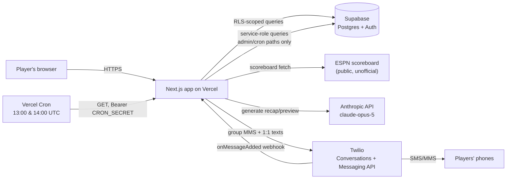

# Hardwood — NBA Over/Unders

A season-long prediction contest for 5 friends, built around a draft of NBA
team win-total over/unders — plus an optional Claude-written, Twilio-delivered
weekly group text. Ported from the NFL version of the same contest
([kebrahim/nfl-over-unders](https://github.com/kebrahim/nfl-over-unders)).

The name is a setting, not hardcoded: set `NEXT_PUBLIC_APP_NAME` on Vercel
(or change the default in `src/lib/config/app.ts`) to rename it everywhere,
texts included.

## How the contest works

**The draft.** Before opening night, every NBA team is assigned a win-total
line (e.g. Thunder 60.5). Each team offers two draftable picks: **Over** and
**Under**. The 5 players take turns in a snake draft for 6 rounds (30 picks
total). Once a player takes "Thunder Over," no one else can take it — but
"Thunder Under" is still open for anyone, including the same player. Most of
the 60 possible (team, side) slots go undrafted; only the 30 that get picked
matter.

**Scoring a pick.** Each drafted pick is checked against the team's win total
over its 82-game regular season:
- Correct side: **1 point**
- Bonus: **+0.25 points per full win of margin** beyond the line, capped at
  **+3 bonus points** (reached at 12 wins of margin)
- Wrong side: **0 points**, no penalty

A pick **locks in as soon as it's mathematically decided** rather than
waiting for game 82: an Over the moment the team's wins pass the line, an
Under the moment even winning every remaining game couldn't reach it. Until
the season ends, the bonus uses the margin that's already guaranteed (for an
Under, measured against the most wins still possible), so a locked pick's
points only ever go up. Lines are always x.5, so there are no pushes.

**Division bonus.** Separately from the draft, each player predicts the
winner of all 6 NBA divisions (Atlantic, Central, Southeast, Northwest,
Pacific, Southwest) before opening tip. Each correct prediction is worth
**1 point** (6 max).

**Tiebreaker.** Each player guesses the total points scored across all 1,230
regular-season games (the NBA Cup final and the playoffs excluded). If the
overall standings are tied at the end of the season, the closest guess wins.

**Final score** = sum of all draft pick points + division bonus points.

**Trend.** The Leaderboard and My Picks show, for every drafted team, the
win total it's on pace for (and which side of the line that lands on), plus
the record it needs over its remaining games for the pick to hit (e.g.
"31-20 or better" for an Over, "20-31 or worse" for an Under).

---

## Architecture

### Stack

| Layer | Choice |
|---|---|
| Framework | [Next.js](https://nextjs.org) App Router, TypeScript, server components + server actions |
| Database, Auth, RLS | [Supabase](https://supabase.com) (Postgres) |
| Styling | [Tailwind CSS](https://tailwindcss.com) |
| Recap/preview text generation | [Anthropic API](https://docs.claude.com) — `claude-opus-5` |
| Group text delivery | [Twilio Conversations](https://www.twilio.com/docs/conversations) (group MMS) + Twilio Messaging API (1:1) |
| Score data | ESPN's public (unofficial) NBA scoreboard endpoint |
| Hosting | [Vercel](https://vercel.com), including Vercel Cron |

### System overview



### Auth & authorization

- Email/password auth via Supabase Auth. `handle_new_user` (a trigger on
  `auth.users`, from the NFL app) creates the shared `public.profiles` row
  on signup; the first Hardwood visit adds it to `nba.players`.
- Nearly every table is readable by any signed-in player — it's a 5-person
  pool, there's no reason to hide anyone's picks from each other. Writes are
  gated per-table, either to the row's own owner (`auth.uid() = id`/`user_id`)
  or to the commissioner (`is_commissioner()`, a small RLS helper function).
- `profiles.is_commissioner`, `profiles.is_demo`, and
  `profiles.sms_opted_out_at` are "privileged" columns: a `before update`
  trigger (`protect_privileged_profile_columns`) silently reverts any change
  a signed-in user makes to them directly, since the general "users can
  update their own profile" policy would otherwise let anyone self-promote
  to commissioner or clear their own opt-out. Service-role writes (used by
  server code, e.g. the opt-out webhook) bypass this — the trigger only
  fires for the `authenticated` role.
- **Demo mode**: a real `profiles` row with `is_demo = true`, not a
  synthetic session. Every page branches on `profile.is_demo` and serves
  static fixture data (`src/lib/demo/data.ts`) instead of querying Supabase;
  every mutating server action independently rejects demo accounts
  server-side, so a demo user can't write real data even by calling an
  action directly.
- `src/proxy.ts` (Next.js middleware) + `src/lib/supabase/proxy.ts` refresh
  the auth session cookie on every request and redirect signed-out visitors
  to `/login`, except for `/login`, `/privacy`, `/terms`, and everything
  under `/api/` (API routes do their own auth check per-route).

### Data model

| Table | Purpose |
|---|---|
| `players` | Who's in the Hardwood contest (joined on first sign-in) |
| `profiles` | A view over the NFL app's shared `public.profiles`, limited to Hardwood players: display name, email, phone, commissioner/demo flags, SMS opt-out state |
| `teams` | The 30 NBA teams, each with a `win_total_line` |
| `games` | Synced from ESPN; team records and the league-wide point total are both derived from this, not stored separately. `counts_toward_record` is false only for the NBA Cup final, which the NBA leaves out of the standings |
| `draft_sessions` / `draft_picks` | The single 6-round snake draft; a pick is `(team, side)`, not just a team |
| `division_predictions` / `division_winners` | Each player's division picks, and the commissioner-recorded actual winners |
| `tiebreaker_predictions` | Each player's total-points guess |
| `app_settings` | Generic key/value store — see below |
| `sent_messages` | Audit trail of every text actually sent (kind, target, full body, timestamp) — commissioner-readable only |

Derived, read-only SQL views (see `supabase/migrations/0001_init.sql`):
`team_records`, `league_total_points`, `draft_pick_scores` (early
resolution and the guaranteed-margin bonus), `overall_leaderboard`
(excludes demo accounts).

`app_settings` keys in use:

| Key | Set by | Meaning |
|---|---|---|
| `sms_conversation_sid` | `/admin` "Create SMS group text" | The Twilio Conversation backing the group thread |
| `sms_draft_enabled` | `/admin` "Group text" | On/off switch for draft texts (`"true"` = on; off by default) |
| `sms_weekly_enabled` | `/admin` "Group text" | On/off switch for the weekly text (`"true"` = on; off by default) |
| `weekly_recap_tone` | `/admin` "Text tone" | Which tone preset Claude writes the weekly text in |
| `last_weekly_summary_week` | sync job | Last week the weekly text was sent for (send-once guard) |
| `last_synced_at` | sync job | Timestamp of the last successful ESPN fetch, shown on Leaderboard/Standings/Admin |

Migrations are numbered and applied in order — see `supabase/migrations/`.
Everything lives in the `nba` schema of the NFL app's Supabase project;
`0001_init.sql` assumes the NFL migrations are already applied there.
There's no automated migration runner for this repo; apply each new
migration's SQL by hand in the Supabase SQL editor when it's added.

### Score sync pipeline

`src/app/api/sync/games/route.ts` does the work; it's reachable two ways:

- **`GET`**, with `Authorization: Bearer $CRON_SECRET` — Vercel Cron. Vercel
  Cron on the Hobby plan only guarantees an invocation *somewhere within*
  the scheduled hour, not the exact minute, and can't run more than once a
  day per job — so `vercel.json` schedules the route twice (`13:00` and
  `14:00` UTC, the two UTC hours 9am can fall on across the EDT/EST
  boundary), and the route itself checks the *live* local hour in
  `America/New_York` and no-ops unless it's genuinely the 9am hour there.
  Whichever of the two invocations actually lands in that hour does the
  real work; the other is a cheap no-op. This self-corrects across the DST
  changeover with no manual schedule flip.
- **`POST`**, from a signed-in commissioner — the "Sync scores now" button
  on `/admin`. Not subject to the 9am gate; runs immediately.

Once running, it fetches ESPN's NBA scoreboard for a ±9-day window (one
request per calendar month, `limit=1000`), keeps only regular-season events
(ESPN season type 2 — no preseason, play-in or playoffs), computes each
game's contest week from its own tip-off time, flags the NBA Cup final
(from ESPN's competition notes) so it doesn't count toward records, and
upserts by ESPN's event `id` (safe to re-run).

**Week computation** (`computeWeek`, `src/lib/domain/season.ts`) buckets
games into Monday-to-Sunday weeks in America/New_York, starting the Monday of
opening night. It compares each tip-off's **ET calendar date**, not a raw UTC
timestamp — a late West Coast tip on Sunday is already Monday in UTC.

Every successful fetch (regardless of whether any games actually changed)
records `last_synced_at` in `app_settings`, which is what Leaderboard,
Standings, and `/admin` display.

### Scoring & derived data

`scorePick()` (`src/lib/domain/scoring.ts`) implements the point formula
described above and is mirrored by the `draft_pick_scores` SQL view — the
two are kept in sync by hand if the formula ever changes. `projectedWins`,
`recordNeeded` and `projectedLeaguePoints` compute the display-only trend
figures (Leaderboard, My Picks, Standings, and the weekly text's context);
they're never used for actual scoring.

### Notifications

**Group MMS setup.** The commissioner creates one Twilio Conversation per
season from `/admin`, once every player has a phone number on file. Each
real player joins as an `Address`-only participant (their own phone
number); one additional "unattached" `ProjectedAddress`-only participant
represents the app's own sending identity — without it, Twilio rejects
every outbound message with error 50513 ("message author should be among
group MMS participants"), since every message's `Author` has to match a
real participant. See `src/lib/notify/sms.ts` and
`src/app/api/admin/sms/setup/route.ts`.

**On/off switches.** Draft texts and the weekly text each have their own
switch under `/admin` → Group text, and both are **off** until the
commissioner turns them on. The test buttons there work either way.

**Automatic texts:**
- Draft texts: draft starts, each pick, draft completes (`src/app/api/draft/start`,
  `.../draft/pick`)
- **Weekly text** — once a Monday-Sunday week is over and its games are all
  final (normally the Monday 9am ET sync), one message: `Week N Recap`
  bullets on drafted teams' results, then `Week N+1 Preview` bullets on the
  week ahead, in whatever tone the commissioner picked. Claude gets each
  pick's record, pace and record-needed as context. Falls back to a plain
  scoring-pace line if `ANTHROPIC_API_KEY` isn't set or generation fails.

The weekly text is idempotent per week via `last_weekly_summary_week`, so
the once-a-day sync job can check every run without double-sending. Weeks
that pass while texting is off are still marked done, so turning it back on
doesn't send a backlog. Generation uses `output_config: { effort: "low" }`;
a response that hits the token cap is discarded rather than sent truncated.

**Tone.** Four presets — Nice, Playful, Snarky, Brutal — stored as one
`app_settings` value and applied to both halves of the weekly text
(`src/lib/notify/weekly-recap.ts`). Adjustable any time from `/admin`.

**Message log.** Every text `sendGroupText`/`sendDirectText` actually sends
is logged to `sent_messages` (kind, target, full body, timestamp) —
commissioner-only, shown on `/admin` under "Message log", so there's a
record beyond someone's actual phone.

**Opt-outs.** `src/app/api/twilio/inbound/route.ts` receives Twilio
Conversations' `onMessageAdded` webhook; a STOP-family reply sets
`profiles.sms_opted_out_at`, a START-family reply clears it. Auth is a
shared secret in the webhook URL's query string rather than full
request-signature validation. Twilio blocks delivery to an opted-out number
at the carrier level regardless of whether this webhook is even configured
— it only makes that state visible in the app.

**Admin test matrix.** `/admin`'s "Group text" section can send the
weekly text (for the latest week with any final game) or a plain connectivity test to either the commissioner's own
phone or the real group thread, on demand — the same generation/send code
paths as the automated jobs, useful for previewing tone changes or
verifying Twilio wiring without waiting for a real game day.

### Admin tooling

`/admin` (commissioner-only) is a set of collapsible sections
(`src/app/admin/section.tsx`, native `<details>`/`<summary>` — no client JS
needed): Participants, Scores (sync status + manual trigger), Group text
(setup + message tests), Text tone, Message log, Draft controls, Win-total
lines, Division winners.

---

## Project structure

```
src/
  app/
    page.tsx                    Home — live season status banner + rules
    login/                      Sign in / sign up
    profile/                    Edit display name, email, phone/SMS opt-in
    draft/                      Live draft board
    leaderboard/                Overall standings + everyone's picks
    my-picks/                   A player's picks, division call, tiebreaker
    standings/                  Live NBA team records vs. win-total lines
    admin/                      Commissioner tools (collapsible sections)
    privacy/, terms/            Static pages (required for Twilio A2P review)
    api/
      draft/start/              Commissioner: start the draft
      draft/pick/                Make a draft pick
      draft/reset/, undo-last-pick/   Commissioner draft controls
      sync/games/                ESPN sync — cron + manual trigger
      admin/sms/setup/           Commissioner: create the group MMS thread
      admin/sms/test/            Send a connectivity test to self
      admin/sms/test-group/      Send a connectivity test to the group
      admin/sms/test-message/    Send a generated recap/preview to self or group
      twilio/inbound/            Twilio webhook — STOP/START opt-out tracking
  lib/
    supabase/                    Browser/server/service-role Supabase clients
    config/                      App name + public URL (the rename switch)
    domain/                      Draft order, scoring math, contest week math,
                                  sync-status tracking, shared types
    notify/                      Twilio sending, Claude recap/preview generation
    demo/                        Static fixture dataset for the read-only demo account
supabase/
  migrations/                    SQL schema (tables, views, RLS policies), numbered
  seed.sql                       30 NBA teams (name, code, conference, division)
  win_totals_2026_27.sql         2026-27 win-total lines (one-off data load)
```

## Environment variables

See `.env.local.example` for the full annotated list. Summary:

| Variable | Required for |
|---|---|
| `NEXT_PUBLIC_SUPABASE_URL`, `NEXT_PUBLIC_SUPABASE_ANON_KEY`, `SUPABASE_SERVICE_ROLE_KEY` | Everything |
| `TWILIO_ACCOUNT_SID`, `TWILIO_AUTH_TOKEN`, `TWILIO_PHONE_NUMBER`, `TWILIO_MESSAGING_SERVICE_SID` | Group texting |
| `TWILIO_INBOUND_WEBHOOK_SECRET` | Opt-out tracking (optional — Twilio still blocks delivery without it) |
| `ANTHROPIC_API_KEY` | Claude-generated recap/preview text (optional — falls back to a plain line) |
| `CRON_SECRET` | Authorizing Vercel Cron's daily sync call |
| `NEXT_PUBLIC_APP_NAME` | Optional rename (defaults to Hardwood) |
| `NEXT_PUBLIC_SITE_URL` | Optional public URL for links in texts |

## Getting started

```bash
npm install
cp .env.local.example .env.local  # fill in your Supabase project values
npm run dev
```

Open [http://localhost:3000](http://localhost:3000) to see the app.

## Deploying

Hardwood shares the NFL contest's Supabase project (one free-plan project,
one set of logins): its tables live in a separate `nba` schema, and accounts
come from the NFL app's `public.profiles`.

1. **Supabase** (the existing NFL project). In the SQL editor, run
   `supabase/migrations/0001_init.sql`, then `supabase/seed.sql`, then
   `supabase/win_totals_2026_27.sql` (copy/paste each file, in that order).
   Then:
   - Project Settings → Data API → **Exposed schemas**: add `nba` and save.
   - Authentication → URL Configuration → **Redirect URLs**: add the
     Hardwood URL (e.g. `https://nba-overunders-liart.vercel.app/**`).
     Leave the Site URL pointing at the NFL app.
2. **Vercel.** Set the environment variables above. The three Supabase
   values are the *same* as the NFL app's. Add a new random `CRON_SECRET`,
   and the Twilio/Anthropic keys if you want texts. Redeploy.
3. **Players.** Everyone signs in with their existing NFL email and
   password; the first visit adds them to Hardwood (`nba.players`). The
   commissioner and demo flags carry over from the NFL app.
4. `vercel.json` registers the sync cron automatically on deploy. For
   opt-out tracking, separately configure the Twilio Conversations webhook
   as described in `.env.local.example`/`src/app/api/twilio/inbound/route.ts`.

Because accounts are shared, profile edits (display name, email, phone)
show up in both apps, and anyone who signs up on either site gets an
account on both — they only count toward Hardwood once they sign in here.

**Season dates to update next year:** `PICKS_LOCK_AT` and
`SEASON_WEEK_1_START_ET_DATE` in `src/lib/domain/season.ts`, the matching
lock timestamps in the migration's division-pick policies, and the lines file.
